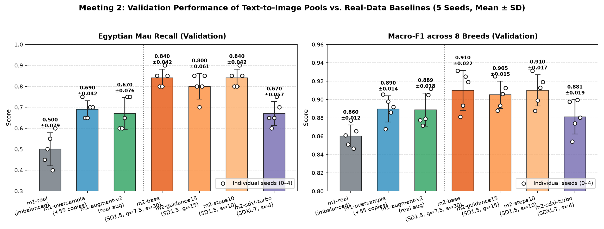

# Experiment Log

Keep one section per meeting. Add the tables and plots you make from
`runs/*/results.json` and `test-results.json` (save the plots in `evidence/`),
link the pools' contact sheets, and explain what you see. A result that shows no
effect is still a result: say so and say why.

## Meeting 1 — Real-data baselines

- **Question:** How much do oversampling and ordinary augmentation help Egyptian
  Mau recall compared with the imbalanced data?
- **How `oversample()` works:** Given the 15 Egyptian Mau training photos and a fixed budget of 55 added examples, `oversample()` computes `full_repeats, remainder = divmod(budget, len(minority_photos))` (which yields 3 full repeats = 45 copies, and a remainder of 10). It repeats every photo 3 times, deterministically selects 10 distinct photos without replacement via `rng.sample(list(minority_photos), remainder)` so that every photo is repeated either 3 or 4 times (differing by at most 1 copy), and shuffles the final 55-element list in-place using `rng.shuffle(chosen)` for seed-level reproducibility.
- **How `augment()` works, and why these transforms:** Because `TRAIN_TRANSFORM` in `train.py` already applies `RandomResizedCrop(224, scale=(0.75, 1.0))`, `RandomHorizontalFlip()`, and `ColorJitter(0.15, 0.15, 0.15)` to every training image, `augment()` defines a module-level `torchvision.transforms.Compose` pipeline that operates on PIL images before `TRAIN_TRANSFORM` without introducing redundant cropping. We evaluated two variants in an ablation study:
  - **`m1-augment` (stronger affine + colour jitter):** Combines `RandomHorizontalFlip(p=0.5)`, `RandomAffine(degrees=15, translate=(0.08, 0.08), scale=(0.9, 1.1), interpolation=BILINEAR)`, and `ColorJitter(brightness=0.2, contrast=0.2, saturation=0.2, hue=0.05)`.
  - **`m1-augment-v2` (milder rotation + colour jitter, chosen after ablation):** Combines `RandomHorizontalFlip(p=0.5)`, `RandomRotation(degrees=8, interpolation=BILINEAR)`, and `ColorJitter(brightness=0.1, contrast=0.1, saturation=0.1)` (no hue shift and no extra affine translation/scaling). Because `TRAIN_TRANSFORM` subsequently applies its own random crop and colour jitter, keeping the minority-specific augmentation milder avoids compounding geometric and colour distortions that can obscure the fine spotted coat pattern of Egyptian Mau. On validation, `m1-augment-v2` improved mean Egyptian Mau recall from `0.650 ± 0.061` to `0.670 ± 0.076` and mean Macro-F1 from `0.877 ± 0.013` to `0.889 ± 0.018`.
- **Commands:**
  ```bash
  uv run synth-data
  uv run pytest
  uv run synth-train --name m1-real --method real
  uv run synth-train --name m1-oversample --method oversample
  uv run synth-train --name m1-augment --method augment
  uv run synth-train --name m1-augment-v2 --method augment
  uv run synth-test --run m1-real
  uv run synth-test --run m1-oversample
  uv run synth-test --run m1-augment
  uv run synth-test --run m1-augment-v2
  ```
- **Results on validation:**

  | Run | Method | Metric | Seed 0 | Seed 1 | Seed 2 | Seed 3 | Seed 4 | Mean ± SD |
  | --- | --- | --- | ---: | ---: | ---: | ---: | ---: | ---: |
  | `m1-real` | `real` (imbalanced) | Egyptian Mau Recall | 0.450 | 0.500 | 0.550 | 0.400 | 0.600 | **0.500 ± 0.079** |
  | `m1-real` | `real` (imbalanced) | Macro-F1 | 0.861 | 0.851 | 0.877 | 0.846 | 0.865 | **0.860 ± 0.012** |
  | `m1-oversample` | `oversample` (+55 copies) | Egyptian Mau Recall | 0.750 | 0.650 | 0.650 | 0.700 | 0.700 | **0.690 ± 0.042** |
  | `m1-oversample` | `oversample` (+55 copies) | Macro-F1 | 0.905 | 0.868 | 0.898 | 0.886 | 0.892 | **0.890 ± 0.014** |
  | `m1-augment` | `augment` (v1: stronger) | Egyptian Mau Recall | 0.600 | 0.600 | 0.650 | 0.750 | 0.650 | **0.650 ± 0.061** |
  | `m1-augment` | `augment` (v1: stronger) | Macro-F1 | 0.871 | 0.858 | 0.879 | 0.893 | 0.885 | **0.877 ± 0.013** |
  | `m1-augment-v2` | `augment` (v2: milder) | Egyptian Mau Recall | 0.600 | 0.600 | 0.650 | 0.750 | 0.750 | **0.670 ± 0.076** |
  | `m1-augment-v2` | `augment` (v2: milder) | Macro-F1 | 0.877 | 0.871 | 0.879 | 0.905 | 0.912 | **0.889 ± 0.018** |

  

- **What I see:** On the imbalanced dataset (`m1-real`), the classifier recognises only half of the validation Egyptian Mau photos on average (`0.500 ± 0.079` recall), while achieving `0.860 ± 0.012` Macro-F1 across all eight breeds. Restoring class balance with 55 evenly distributed copies in `m1-oversample` yields the strongest and most consistent validation improvement: Egyptian Mau recall jumps by +19.0 percentage points to `0.690 ± 0.042` (with every seed reaching at least 0.650), and Macro-F1 rises to `0.890 ± 0.014`, confirming that balancing the minority class does not harm the other seven breeds. Notably, even `m1-oversample` benefits from mild stochastic diversity because `TRAIN_TRANSFORM` applies random resized cropping, horizontal flipping, and colour jitter each time an oversampled copy is drawn. Adding an explicit pre-transform in `m1-augment` (stronger affine + hue/colour jitter) also substantially outperforms `m1-real` (`0.650 ± 0.061` recall, `0.877 ± 0.013` Macro-F1), but slightly trails `m1-oversample` because stacking two layers of colour and geometric distortion slightly blurs the breed's distinctive markings. Reducing the transform intensity in our ablation run `m1-augment-v2` closes most of that gap on validation (`0.670 ± 0.076` recall, `0.889 ± 0.018` Macro-F1, reaching `0.750` recall and `0.912` Macro-F1 on seed 4).
- **Test results of the three baselines:**

  | Run | Method | Metric | Seed 0 | Seed 1 | Seed 2 | Seed 3 | Seed 4 | Mean ± SD |
  | --- | --- | --- | ---: | ---: | ---: | ---: | ---: | ---: |
  | `m1-real` | `real` (imbalanced) | Egyptian Mau Recall | 0.467 | 0.500 | 0.567 | 0.433 | 0.600 | **0.513 ± 0.069** |
  | `m1-real` | `real` (imbalanced) | Macro-F1 | 0.843 | 0.849 | 0.880 | 0.839 | 0.864 | **0.855 ± 0.017** |
  | `m1-oversample` | `oversample` (+55 copies) | Egyptian Mau Recall | 0.700 | 0.667 | 0.667 | 0.700 | 0.733 | **0.693 ± 0.028** |
  | `m1-oversample` | `oversample` (+55 copies) | Macro-F1 | 0.883 | 0.882 | 0.886 | 0.875 | 0.866 | **0.878 ± 0.008** |
  | `m1-augment` | `augment` (v1: stronger) | Egyptian Mau Recall | 0.633 | 0.600 | 0.667 | 0.700 | 0.700 | **0.660 ± 0.043** |
  | `m1-augment` | `augment` (v1: stronger) | Macro-F1 | 0.869 | 0.859 | 0.890 | 0.895 | 0.882 | **0.879 ± 0.015** |
  | `m1-augment-v2` | `augment` (v2: milder, chosen) | Egyptian Mau Recall | 0.633 | 0.633 | 0.667 | 0.700 | 0.667 | **0.660 ± 0.028** |
  | `m1-augment-v2` | `augment` (v2: milder, chosen) | Macro-F1 | 0.860 | 0.869 | 0.882 | 0.883 | 0.882 | **0.875 ± 0.010** |

## Meeting 2 — Text-to-image generation

- **Question:** Can unconditioned text-to-image (T2I) diffusion pools improve Egyptian Mau recognition beyond classical oversampling and augmentation, and how do guidance scale, denoising step count, and model architecture (SD 1.5 vs. SDXL-Turbo) affect visual fidelity and downstream classifier accuracy?
- **Setting changed in each pool (one at a time):**

  | Pool | Model | Steps | Guidance | Scheduler | Prompts | Usable / Total (`manifest.jsonl`) | Changed Setting |
  | --- | --- | ---: | ---: | --- | --- | ---: | --- |
  | `m2-base` | `sd15` | 30 | 7.5 | `dpm` | 2 alternating prompts (indoor lighting / studio portrait on a rug) | 109 / 110 (1 `safety_blocked`) | Baseline T2I configuration |
  | `m2-guidance15` | `sd15` | 30 | **15.0** | `dpm` | Same 2 alternating prompts | 110 / 110 | Increased classifier-free guidance (`7.5 -> 15.0`) |
  | `m2-steps10` | `sd15` | **10** | 7.5 | `dpm` | Same 2 alternating prompts | 109 / 110 (1 `safety_blocked`) | Reduced denoising steps (`30 -> 10`) |
  | `m2-sdxl-turbo` | **`sdxl-turbo`** | **4** | **0.0** | `default` | 1 close-up prompt ("a sharp close-up photo of an Egyptian Mau cat...") | 110 / 110 | Architecture switched to adversarial-distilled `sdxl-turbo` |

- **Commands:**
  ```bash
  # Generation commands (executed on GPU to create pools/)
  uv run synth-generate --name m2-base \
      --prompt "a clear photography of a spotted Egyptian Mau cat, green gooseberry eyes, detailed fur, indoor lighting" \
      --prompt "a studio portrait of an Egyptian Mau cat sitting on a rug, sharp focus, natural colors" \
      --negative-prompt "illustration, painting, cartoon, text, watermark, multiple cats, deformed animal, extra limbs"
  uv run synth-generate --name m2-guidance15 --guidance 15.0 \
      --prompt "a clear photography of a spotted Egyptian Mau cat, green gooseberry eyes, detailed fur, indoor lighting" \
      --prompt "a studio portrait of an Egyptian Mau cat sitting on a rug, sharp focus, natural colors" \
      --negative-prompt "illustration, painting, cartoon, text, watermark, multiple cats, deformed animal, extra limbs"
  uv run synth-generate --name m2-steps10 --steps 10 \
      --prompt "a clear photography of a spotted Egyptian Mau cat, green gooseberry eyes, detailed fur, indoor lighting" \
      --prompt "a studio portrait of an Egyptian Mau cat sitting on a rug, sharp focus, natural colors" \
      --negative-prompt "illustration, painting, cartoon, text, watermark, multiple cats, deformed animal, extra limbs"
  uv run synth-generate --name m2-sdxl-turbo --model sdxl-turbo \
      --prompt "a sharp close-up photo of an Egyptian Mau cat with dark spots on light silver fur, green eyes" \
      --negative-prompt "illustration, painting, cartoon, text, watermark, multiple cats, deformed animal, extra limbs"

  # Classifier training & evaluation commands
  uv run synth-train --name m2-base --method synthetic --pool m2-base
  uv run synth-train --name m2-guidance15 --method synthetic --pool m2-guidance15 --tag guidance=15
  uv run synth-train --name m2-steps10 --method synthetic --pool m2-steps10 --tag steps=10
  uv run synth-train --name m2-sdxl-turbo --method synthetic --pool m2-sdxl-turbo --tag model=sdxl-turbo
  uv run synth-test --run m2-base
  ```
- **Contact sheets:**
  - [`pools/m2-base/contact-sheet.jpg`](pools/m2-base/contact-sheet.jpg): Good pose and scene variety (alternating between close-up portraits and full-body shots sitting or lying on patterned rugs, e.g., `#3`, `#4`, `#9`, `#14`). However, several typical SD 1.5 failure modes appear: **coat pattern confusion** (`#1` shows large hollow rosettes typical of a Bengal rather than discrete Egyptian Mau spots; `#7` and `#23` show heavy mackerel stripes on the legs and chest), **anatomical truncation/cropping** (`#5` renders a headless cat body on a rug), and **ocular/close-up artifacts** (`#0` and `#12` are extreme macro shots of the nose bridge with cloudy, cataract-like or glowing eyes).
  - [`pools/m2-guidance15/contact-sheet.jpg`](pools/m2-guidance15/contact-sheet.jpg): Doubling guidance to `15.0` forces stronger adherence to prompt tokens, which fixes the headless framing in `#5` and restores full faces in `#0` and `#12`. However, it introduces **colour oversaturation and high-contrast posterisation**: eyes turn neon green or glowing amber (`#0`, `#4`, `#6`, `#10`, `#20`), fur contrast becomes harsh and synthetic-looking, and **anatomical elongation** appears (`#21` has an unnaturally long, rigid tail extending across the floor).
  - [`pools/m2-steps10/contact-sheet.jpg`](pools/m2-steps10/contact-sheet.jpg): With only 10 DPM solver steps, overall composition matches `m2-base` for easy seeds (`#4`, `#8`, `#14`), but under-converged trajectories produce severe **structural and anatomical deformations**: **multi-body / conjoined cats** (`#3` and `#21` fuse two cat bodies and extra limbs on the rug), **melted facial geometry** (`#7` has a collapsed head merged into the torso; `#6` and `#12` have distorted ear cartilage and Asymmetric eyes), and rougher high-frequency fur textures.
  - [`pools/m2-sdxl-turbo/contact-sheet.jpg`](pools/m2-sdxl-turbo/contact-sheet.jpg): Every single image in the 24-sample sheet is sharp, well-lit, and anatomically coherent, with realistic silver-spotted fur and green eyes. Yet it suffers from severe **compositional mode collapse**: because `sdxl-turbo` runs with `guidance=0.0` in 4 steps from a single close-up prompt, all 24 images are nearly identical tight frontal face crops filling 90% of the frame, providing zero full-body posture, background, or scale diversity.
- **Results on validation:**

  | Run | Method / Pool | Metric | Seed 0 | Seed 1 | Seed 2 | Seed 3 | Seed 4 | Mean ± SD |
  | --- | --- | --- | ---: | ---: | ---: | ---: | ---: | ---: |
  | `m1-real` | `real` (imbalanced) | Egyptian Mau Recall | 0.450 | 0.500 | 0.550 | 0.400 | 0.600 | **0.500 ± 0.079** |
  | `m1-real` | `real` (imbalanced) | Macro-F1 | 0.861 | 0.851 | 0.877 | 0.846 | 0.865 | **0.860 ± 0.012** |
  | `m1-oversample` | `oversample` (+55 copies) | Egyptian Mau Recall | 0.750 | 0.650 | 0.650 | 0.700 | 0.700 | **0.690 ± 0.042** |
  | `m1-oversample` | `oversample` (+55 copies) | Macro-F1 | 0.905 | 0.868 | 0.898 | 0.886 | 0.892 | **0.890 ± 0.014** |
  | `m1-augment-v2` | `augment` (v2: milder) | Egyptian Mau Recall | 0.600 | 0.600 | 0.650 | 0.750 | 0.750 | **0.670 ± 0.076** |
  | `m1-augment-v2` | `augment` (v2: milder) | Macro-F1 | 0.877 | 0.871 | 0.879 | 0.905 | 0.912 | **0.889 ± 0.018** |
  | `m2-base` | `synthetic` (`sd15`, g=7.5, s=30) | Egyptian Mau Recall | 0.850 | 0.800 | 0.800 | 0.900 | 0.850 | **0.840 ± 0.042** |
  | `m2-base` | `synthetic` (`sd15`, g=7.5, s=30) | Macro-F1 | 0.931 | 0.881 | 0.893 | 0.925 | 0.919 | **0.910 ± 0.022** |
  | `m2-guidance15` | `synthetic` (`sd15`, g=15.0, s=30) | Egyptian Mau Recall | 0.850 | 0.800 | 0.700 | 0.800 | 0.850 | **0.800 ± 0.061** |
  | `m2-guidance15` | `synthetic` (`sd15`, g=15.0, s=30) | Macro-F1 | 0.925 | 0.888 | 0.893 | 0.906 | 0.913 | **0.905 ± 0.015** |
  | `m2-steps10` | `synthetic` (`sd15`, g=7.5, s=10) | Egyptian Mau Recall | 0.850 | 0.800 | 0.800 | 0.900 | 0.850 | **0.840 ± 0.042** |
  | `m2-steps10` | `synthetic` (`sd15`, g=7.5, s=10) | Macro-F1 | 0.931 | 0.887 | 0.899 | 0.913 | 0.919 | **0.910 ± 0.017** |
  | `m2-sdxl-turbo` | `synthetic` (`sdxl-turbo`, g=0.0, s=4) | Egyptian Mau Recall | 0.650 | 0.600 | 0.650 | 0.750 | 0.700 | **0.670 ± 0.057** |
  | `m2-sdxl-turbo` | `synthetic` (`sdxl-turbo`, g=0.0, s=4) | Macro-F1 | 0.897 | 0.854 | 0.874 | 0.899 | 0.880 | **0.881 ± 0.019** |

  

- **What I see:** Adding 55 diverse SD 1.5 text-to-image examples (`m2-base` and `m2-steps10`) substantially outperforms every real-data baseline from Meeting 1 on the validation split. Specifically, `m2-base` boosts mean Egyptian Mau recall to `0.840 ± 0.042` (+34.0 pp over `m1-real` and +15.0 pp over `m1-oversample`) while simultaneously raising overall 8-breed Macro-F1 to `0.910 ± 0.022` (vs. `0.890 ± 0.014` for `m1-oversample`). Even though occasional SD 1.5 samples have anatomical flaws, the new combinations of poses, lighting, and spotted fur patterns prevent the classifier from overfitting to the 15 training photos. Comparing the four pools reveals an important lesson: **structural and compositional diversity matters much more to the classifier than per-image photorealism**:
  1. `m2-sdxl-turbo` looks the cleanest to the human eye, yet performs worst among all synthetic pools (`0.670 ± 0.057` recall, `0.881 ± 0.019` Macro-F1 — slightly below `m1-oversample`), because 55 nearly identical frontal face close-ups do not teach the classifier to recognise full-body Egyptian Mau cats in varied validation scenes.
  2. Increasing guidance to `15.0` (`m2-guidance15`) reduces validation recall from `0.840` to `0.800 ± 0.061` (and Macro-F1 to `0.905 ± 0.015`), as oversaturated neon eye colours and harsh contrast shift the synthetic images away from the natural colour distribution of real Oxford-IIIT Pet photos.
  3. Reducing DPM steps from 30 to 10 (`m2-steps10`) matches `m2-base` in mean recall (`0.840 ± 0.042`) and Macro-F1 (`0.910 ± 0.017`), showing that CNN feature extractors are surprisingly tolerant of occasional anatomical artifacts as long as discriminative coat textures and pose variety are preserved.
- **Pool I take forward, and why:** I take **`m2-base`** forward. On validation, `m2-base` ties with `m2-steps10` for the highest Egyptian Mau recall (`0.840 ± 0.042`, with every seed between `0.800` and `0.900`) and highest mean Macro-F1 (`0.910`), while exhibiting far fewer anatomical deformities (such as conjoined bodies or melted heads) on its contact sheet than `m2-steps10`. Moreover, `m2-base` provides the standard 30-step, `guidance=7.5` reference configuration and prompt pair that we can hold fixed when sweeping `img2img` strength and `IP-Adapter` scale in Meeting 3.
- **Its test result, compared with the baselines:**

  | Run | Method | Metric | Seed 0 | Seed 1 | Seed 2 | Seed 3 | Seed 4 | Mean ± SD |
  | --- | --- | --- | ---: | ---: | ---: | ---: | ---: | ---: |
  | `m1-real` | `real` (imbalanced) | Egyptian Mau Recall | 0.467 | 0.500 | 0.567 | 0.433 | 0.600 | **0.513 ± 0.069** |
  | `m1-real` | `real` (imbalanced) | Macro-F1 | 0.843 | 0.849 | 0.880 | 0.839 | 0.864 | **0.855 ± 0.017** |
  | `m1-oversample` | `oversample` (+55 copies) | Egyptian Mau Recall | 0.700 | 0.667 | 0.667 | 0.700 | 0.733 | **0.693 ± 0.028** |
  | `m1-oversample` | `oversample` (+55 copies) | Macro-F1 | 0.883 | 0.882 | 0.886 | 0.875 | 0.866 | **0.878 ± 0.008** |
  | `m1-augment-v2` | `augment` (v2: milder) | Egyptian Mau Recall | 0.633 | 0.633 | 0.667 | 0.700 | 0.667 | **0.660 ± 0.028** |
  | `m1-augment-v2` | `augment` (v2: milder) | Macro-F1 | 0.860 | 0.869 | 0.882 | 0.883 | 0.882 | **0.875 ± 0.010** |
  | `m2-base` | `synthetic` (`m2-base`, chosen) | Egyptian Mau Recall | 0.800 | 0.733 | 0.733 | 0.733 | 0.733 | **0.747 ± 0.030** |
  | `m2-base` | `synthetic` (`m2-base`, chosen) | Macro-F1 | 0.900 | 0.908 | 0.900 | 0.908 | 0.886 | **0.900 ± 0.009** |

  On the held-out test set (240 photos), `m2-base` clearly outperforms all three real-data baselines, improving mean Egyptian Mau recall to **`0.747 ± 0.030`** (+23.4 pp over `m1-real`, +5.4 pp over `m1-oversample`, and +8.7 pp over `m1-augment-v2`) and raising test Macro-F1 to **`0.900 ± 0.009`** (+2.2 pp over `m1-oversample`).

## Meeting 3 — Generation from training photos

- **Question:** How close to the real photos should the synthetic images be?
- **img2img strength values and IP-Adapter scale values tried:**
- **Commands:**
- **Contact sheets:**
- **Results on validation:**
- **What I see:**
- **Best run of each mode, and its test result:**

## Meeting 4 — Editing training photos

- **Question:** Does the classifier need new cats or new backgrounds?
- **Background prompts and outpainting scales tried:**
- **Commands:**
- **Contact sheets:**
- **Results on validation:**
- **What I see:**
- **Best run of each mode, and its test result:**

## Final comparison

- **Runs chosen in Meetings 1–4:**
- **Results:** (your table and plot of their `test-results.json`)
- **Did the validation ranking hold on the test photos?**
- **Recommendation:** use, revise, or reject synthetic data for this task.
