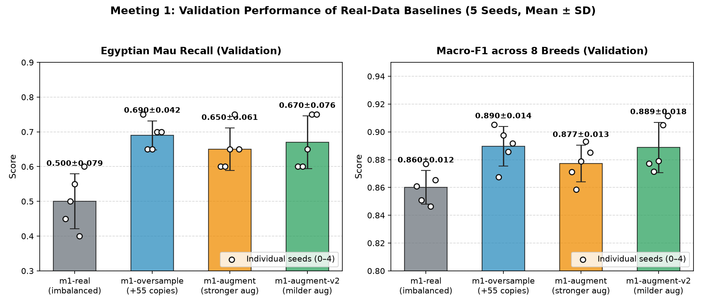
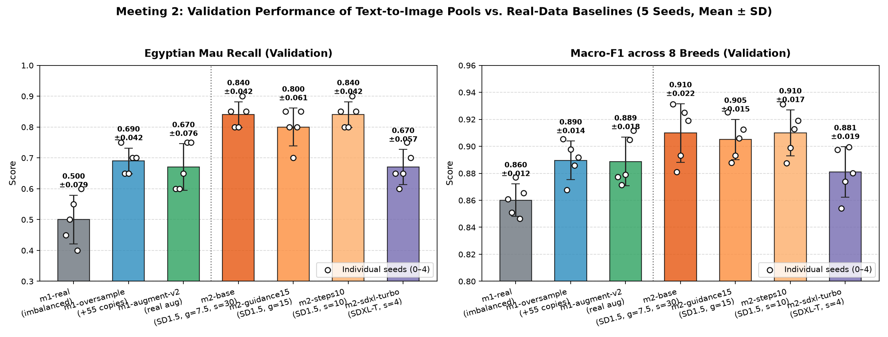
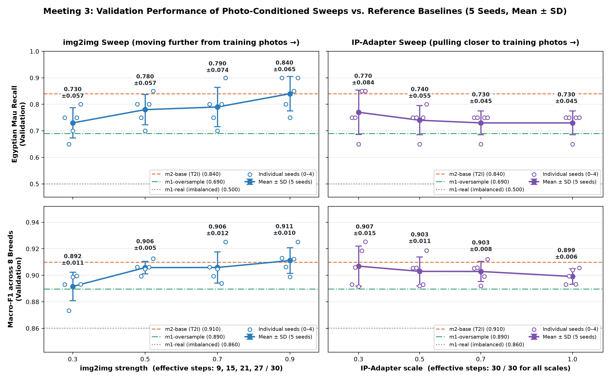

# Experiment Log

Keep one section per meeting. Add the tables and plots you make from
`runs/*/results.json` and `test-results.json` (save the plots in `evidence/`),
link the pools' contact sheets, and explain what you see. A result that shows no
effect is still a result: say so and say why.

## Meeting 1 — Real-data baselines

- **Question:** How much do oversampling and ordinary augmentation help Egyptian
  Mau recall compared with the imbalanced data?
- **How `oversample()` works:** Given the 15 Egyptian Mau training photos and a fixed budget of 55 added examples, `oversample()` computes `full_repeats, remainder = divmod(budget, len(minority_photos))` (which yields 3 full repeats = 45 copies, and a remainder of 10). It repeats every photo 3 times, deterministically selects 10 distinct photos without replacement via `rng.sample(list(minority_photos), remainder)` so that every photo is repeated either 3 or 4 times (differing by at most 1 copy), and shuffles the final 55-element list in-place using `rng.shuffle(chosen)` for seed-level reproducibility.
- **How `augment()` works, and why these transforms:** Because `TRAIN_TRANSFORM` in `train.py` already applies `RandomResizedCrop(224, scale=(0.75, 1.0))`, `RandomHorizontalFlip()`, and `ColorJitter(0.15, 0.15, 0.15)` to every training image, `augment()` defines a module-level `torchvision.transforms.Compose` pipeline that operates on PIL images before `TRAIN_TRANSFORM` without introducing redundant cropping. We evaluated two variants in an ablation study:
  - **`m1-augment` (stronger affine + colour jitter):** Combines `RandomHorizontalFlip(p=0.5)`, `RandomAffine(degrees=15, translate=(0.08, 0.08), scale=(0.9, 1.1), interpolation=BILINEAR)`, and `ColorJitter(brightness=0.2, contrast=0.2, saturation=0.2, hue=0.05)`.
  - **`m1-augment-v2` (milder rotation + colour jitter, chosen after ablation):** Combines `RandomHorizontalFlip(p=0.5)`, `RandomRotation(degrees=8, interpolation=BILINEAR)`, and `ColorJitter(brightness=0.1, contrast=0.1, saturation=0.1)` (no hue shift and no extra affine translation/scaling). Because `TRAIN_TRANSFORM` subsequently applies its own random crop and colour jitter, keeping the minority-specific augmentation milder avoids compounding geometric and colour distortions that can obscure the fine spotted coat pattern of Egyptian Mau. On validation, `m1-augment-v2` improved mean Egyptian Mau recall from `0.650 ± 0.061` to `0.670 ± 0.076` and mean Macro-F1 from `0.877 ± 0.013` to `0.889 ± 0.018`.
- **Commands:**
  ```bash
  uv run synth-data
  uv run pytest
  uv run synth-train --name m1-real --method real
  uv run synth-train --name m1-oversample --method oversample
  uv run synth-train --name m1-augment --method augment
  uv run synth-train --name m1-augment-v2 --method augment
  uv run synth-test --run m1-real
  uv run synth-test --run m1-oversample
  uv run synth-test --run m1-augment
  uv run synth-test --run m1-augment-v2
  ```
- **Results on validation:**

  | Run | Method | Metric | Seed 0 | Seed 1 | Seed 2 | Seed 3 | Seed 4 | Mean ± SD |
  | --- | --- | --- | ---: | ---: | ---: | ---: | ---: | ---: |
  | `m1-real` | `real` (imbalanced) | Egyptian Mau Recall | 0.450 | 0.500 | 0.550 | 0.400 | 0.600 | **0.500 ± 0.079** |
  | `m1-real` | `real` (imbalanced) | Macro-F1 | 0.861 | 0.851 | 0.877 | 0.846 | 0.865 | **0.860 ± 0.012** |
  | `m1-oversample` | `oversample` (+55 copies) | Egyptian Mau Recall | 0.750 | 0.650 | 0.650 | 0.700 | 0.700 | **0.690 ± 0.042** |
  | `m1-oversample` | `oversample` (+55 copies) | Macro-F1 | 0.905 | 0.868 | 0.898 | 0.886 | 0.892 | **0.890 ± 0.014** |
  | `m1-augment` | `augment` (v1: stronger) | Egyptian Mau Recall | 0.600 | 0.600 | 0.650 | 0.750 | 0.650 | **0.650 ± 0.061** |
  | `m1-augment` | `augment` (v1: stronger) | Macro-F1 | 0.871 | 0.858 | 0.879 | 0.893 | 0.885 | **0.877 ± 0.013** |
  | `m1-augment-v2` | `augment` (v2: milder) | Egyptian Mau Recall | 0.600 | 0.600 | 0.650 | 0.750 | 0.750 | **0.670 ± 0.076** |
  | `m1-augment-v2` | `augment` (v2: milder) | Macro-F1 | 0.877 | 0.871 | 0.879 | 0.905 | 0.912 | **0.889 ± 0.018** |

  

- **What I see:** On the imbalanced dataset (`m1-real`), the classifier recognises only half of the validation Egyptian Mau photos on average (`0.500 ± 0.079` recall), while achieving `0.860 ± 0.012` Macro-F1 across all eight breeds. Restoring class balance with 55 evenly distributed copies in `m1-oversample` yields the strongest and most consistent validation improvement: Egyptian Mau recall jumps by +19.0 percentage points to `0.690 ± 0.042` (with every seed reaching at least 0.650), and Macro-F1 rises to `0.890 ± 0.014`, confirming that balancing the minority class does not harm the other seven breeds. Notably, even `m1-oversample` benefits from mild stochastic diversity because `TRAIN_TRANSFORM` applies random resized cropping, horizontal flipping, and colour jitter each time an oversampled copy is drawn. Adding an explicit pre-transform in `m1-augment` (stronger affine + hue/colour jitter) also substantially outperforms `m1-real` (`0.650 ± 0.061` recall, `0.877 ± 0.013` Macro-F1), but slightly trails `m1-oversample` because stacking two layers of colour and geometric distortion slightly blurs the breed's distinctive markings. Reducing the transform intensity in our ablation run `m1-augment-v2` closes most of that gap on validation (`0.670 ± 0.076` recall, `0.889 ± 0.018` Macro-F1, reaching `0.750` recall and `0.912` Macro-F1 on seed 4).
- **Test results of the three baselines:**

  | Run | Method | Metric | Seed 0 | Seed 1 | Seed 2 | Seed 3 | Seed 4 | Mean ± SD |
  | --- | --- | --- | ---: | ---: | ---: | ---: | ---: | ---: |
  | `m1-real` | `real` (imbalanced) | Egyptian Mau Recall | 0.467 | 0.500 | 0.567 | 0.433 | 0.600 | **0.513 ± 0.069** |
  | `m1-real` | `real` (imbalanced) | Macro-F1 | 0.843 | 0.849 | 0.880 | 0.839 | 0.864 | **0.855 ± 0.017** |
  | `m1-oversample` | `oversample` (+55 copies) | Egyptian Mau Recall | 0.700 | 0.667 | 0.667 | 0.700 | 0.733 | **0.693 ± 0.028** |
  | `m1-oversample` | `oversample` (+55 copies) | Macro-F1 | 0.883 | 0.882 | 0.886 | 0.875 | 0.866 | **0.878 ± 0.008** |
  | `m1-augment` | `augment` (v1: stronger) | Egyptian Mau Recall | 0.633 | 0.600 | 0.667 | 0.700 | 0.700 | **0.660 ± 0.043** |
  | `m1-augment` | `augment` (v1: stronger) | Macro-F1 | 0.869 | 0.859 | 0.890 | 0.895 | 0.882 | **0.879 ± 0.015** |
  | `m1-augment-v2` | `augment` (v2: milder, chosen) | Egyptian Mau Recall | 0.633 | 0.633 | 0.667 | 0.700 | 0.667 | **0.660 ± 0.028** |
  | `m1-augment-v2` | `augment` (v2: milder, chosen) | Macro-F1 | 0.860 | 0.869 | 0.882 | 0.883 | 0.882 | **0.875 ± 0.010** |

## Meeting 2 — Text-to-image generation

- **Question:** Can unconditioned text-to-image (T2I) diffusion pools improve Egyptian Mau recognition beyond classical oversampling and augmentation, and how do guidance scale, denoising step count, and model architecture (SD 1.5 vs. SDXL-Turbo) affect visual fidelity and downstream classifier accuracy?
- **Setting changed in each pool (one at a time):**

  | Pool | Model | Steps | Guidance | Scheduler | Prompts | Usable / Total (`manifest.jsonl`) | Changed Setting |
  | --- | --- | ---: | ---: | --- | --- | ---: | --- |
  | `m2-base` | `sd15` | 30 | 7.5 | `dpm` | 2 alternating prompts (indoor lighting / studio portrait on a rug) | 109 / 110 (1 `safety_blocked`) | Baseline T2I configuration |
  | `m2-guidance15` | `sd15` | 30 | **15.0** | `dpm` | Same 2 alternating prompts | 110 / 110 | Increased classifier-free guidance (`7.5 -> 15.0`) |
  | `m2-steps10` | `sd15` | **10** | 7.5 | `dpm` | Same 2 alternating prompts | 109 / 110 (1 `safety_blocked`) | Reduced denoising steps (`30 -> 10`) |
  | `m2-sdxl-turbo` | **`sdxl-turbo`** | **4** | **0.0** | `default` | 1 close-up prompt ("a sharp close-up photo of an Egyptian Mau cat...") | 110 / 110 | Architecture switched to adversarial-distilled `sdxl-turbo` |

- **Commands:**
  ```bash
  # Generation commands (executed on GPU to create pools/)
  uv run synth-generate --name m2-base \
      --prompt "a clear photography of a spotted Egyptian Mau cat, green gooseberry eyes, detailed fur, indoor lighting" \
      --prompt "a studio portrait of an Egyptian Mau cat sitting on a rug, sharp focus, natural colors" \
      --negative-prompt "illustration, painting, cartoon, text, watermark, multiple cats, deformed animal, extra limbs"
  uv run synth-generate --name m2-guidance15 --guidance 15.0 \
      --prompt "a clear photography of a spotted Egyptian Mau cat, green gooseberry eyes, detailed fur, indoor lighting" \
      --prompt "a studio portrait of an Egyptian Mau cat sitting on a rug, sharp focus, natural colors" \
      --negative-prompt "illustration, painting, cartoon, text, watermark, multiple cats, deformed animal, extra limbs"
  uv run synth-generate --name m2-steps10 --steps 10 \
      --prompt "a clear photography of a spotted Egyptian Mau cat, green gooseberry eyes, detailed fur, indoor lighting" \
      --prompt "a studio portrait of an Egyptian Mau cat sitting on a rug, sharp focus, natural colors" \
      --negative-prompt "illustration, painting, cartoon, text, watermark, multiple cats, deformed animal, extra limbs"
  uv run synth-generate --name m2-sdxl-turbo --model sdxl-turbo \
      --prompt "a sharp close-up photo of an Egyptian Mau cat with dark spots on light silver fur, green eyes" \
      --negative-prompt "illustration, painting, cartoon, text, watermark, multiple cats, deformed animal, extra limbs"

  # Classifier training & evaluation commands
  uv run synth-train --name m2-base --method synthetic --pool m2-base
  uv run synth-train --name m2-guidance15 --method synthetic --pool m2-guidance15 --tag guidance=15
  uv run synth-train --name m2-steps10 --method synthetic --pool m2-steps10 --tag steps=10
  uv run synth-train --name m2-sdxl-turbo --method synthetic --pool m2-sdxl-turbo --tag model=sdxl-turbo
  uv run synth-test --run m2-base
  ```
- **Contact sheets:**
  - [`pools/m2-base/contact-sheet.jpg`](pools/m2-base/contact-sheet.jpg): Good pose and scene variety (alternating between close-up portraits and full-body shots sitting or lying on patterned rugs, e.g., `#3`, `#4`, `#9`, `#14`). However, several typical SD 1.5 failure modes appear: **coat pattern confusion** (`#1` shows large hollow rosettes typical of a Bengal rather than discrete Egyptian Mau spots; `#7` and `#23` show heavy mackerel stripes on the legs and chest), **anatomical truncation/cropping** (`#5` renders a headless cat body on a rug), and **ocular/close-up artifacts** (`#0` and `#12` are extreme macro shots of the nose bridge with cloudy, cataract-like or glowing eyes).
  - [`pools/m2-guidance15/contact-sheet.jpg`](pools/m2-guidance15/contact-sheet.jpg): Doubling guidance to `15.0` forces stronger adherence to prompt tokens, which fixes the headless framing in `#5` and restores full faces in `#0` and `#12`. However, it introduces **colour oversaturation and high-contrast posterisation**: eyes turn neon green or glowing amber (`#0`, `#4`, `#6`, `#10`, `#20`), fur contrast becomes harsh and synthetic-looking, and **anatomical elongation** appears (`#21` has an unnaturally long, rigid tail extending across the floor).
  - [`pools/m2-steps10/contact-sheet.jpg`](pools/m2-steps10/contact-sheet.jpg): With only 10 DPM solver steps, overall composition matches `m2-base` for easy seeds (`#4`, `#8`, `#14`), but under-converged trajectories produce severe **structural and anatomical deformations**: **multi-body / conjoined cats** (`#3` and `#21` fuse two cat bodies and extra limbs on the rug), **melted facial geometry** (`#7` has a collapsed head merged into the torso; `#6` and `#12` have distorted ear cartilage and Asymmetric eyes), and rougher high-frequency fur textures.
  - [`pools/m2-sdxl-turbo/contact-sheet.jpg`](pools/m2-sdxl-turbo/contact-sheet.jpg): Every single image in the 24-sample sheet is sharp, well-lit, and anatomically coherent, with realistic silver-spotted fur and green eyes. Yet it suffers from severe **compositional mode collapse**: because `sdxl-turbo` runs with `guidance=0.0` in 4 steps from a single close-up prompt, all 24 images are nearly identical tight frontal face crops filling 90% of the frame, providing zero full-body posture, background, or scale diversity.
- **Results on validation:**

  | Run | Method / Pool | Metric | Seed 0 | Seed 1 | Seed 2 | Seed 3 | Seed 4 | Mean ± SD |
  | --- | --- | --- | ---: | ---: | ---: | ---: | ---: | ---: |
  | `m1-real` | `real` (imbalanced) | Egyptian Mau Recall | 0.450 | 0.500 | 0.550 | 0.400 | 0.600 | **0.500 ± 0.079** |
  | `m1-real` | `real` (imbalanced) | Macro-F1 | 0.861 | 0.851 | 0.877 | 0.846 | 0.865 | **0.860 ± 0.012** |
  | `m1-oversample` | `oversample` (+55 copies) | Egyptian Mau Recall | 0.750 | 0.650 | 0.650 | 0.700 | 0.700 | **0.690 ± 0.042** |
  | `m1-oversample` | `oversample` (+55 copies) | Macro-F1 | 0.905 | 0.868 | 0.898 | 0.886 | 0.892 | **0.890 ± 0.014** |
  | `m1-augment-v2` | `augment` (v2: milder) | Egyptian Mau Recall | 0.600 | 0.600 | 0.650 | 0.750 | 0.750 | **0.670 ± 0.076** |
  | `m1-augment-v2` | `augment` (v2: milder) | Macro-F1 | 0.877 | 0.871 | 0.879 | 0.905 | 0.912 | **0.889 ± 0.018** |
  | `m2-base` | `synthetic` (`sd15`, g=7.5, s=30) | Egyptian Mau Recall | 0.850 | 0.800 | 0.800 | 0.900 | 0.850 | **0.840 ± 0.042** |
  | `m2-base` | `synthetic` (`sd15`, g=7.5, s=30) | Macro-F1 | 0.931 | 0.881 | 0.893 | 0.925 | 0.919 | **0.910 ± 0.022** |
  | `m2-guidance15` | `synthetic` (`sd15`, g=15.0, s=30) | Egyptian Mau Recall | 0.850 | 0.800 | 0.700 | 0.800 | 0.850 | **0.800 ± 0.061** |
  | `m2-guidance15` | `synthetic` (`sd15`, g=15.0, s=30) | Macro-F1 | 0.925 | 0.888 | 0.893 | 0.906 | 0.913 | **0.905 ± 0.015** |
  | `m2-steps10` | `synthetic` (`sd15`, g=7.5, s=10) | Egyptian Mau Recall | 0.850 | 0.800 | 0.800 | 0.900 | 0.850 | **0.840 ± 0.042** |
  | `m2-steps10` | `synthetic` (`sd15`, g=7.5, s=10) | Macro-F1 | 0.931 | 0.887 | 0.899 | 0.913 | 0.919 | **0.910 ± 0.017** |
  | `m2-sdxl-turbo` | `synthetic` (`sdxl-turbo`, g=0.0, s=4) | Egyptian Mau Recall | 0.650 | 0.600 | 0.650 | 0.750 | 0.700 | **0.670 ± 0.057** |
  | `m2-sdxl-turbo` | `synthetic` (`sdxl-turbo`, g=0.0, s=4) | Macro-F1 | 0.897 | 0.854 | 0.874 | 0.899 | 0.880 | **0.881 ± 0.019** |

  

- **What I see:** Adding 55 diverse SD 1.5 text-to-image examples (`m2-base` and `m2-steps10`) substantially outperforms every real-data baseline from Meeting 1 on the validation split. Specifically, `m2-base` boosts mean Egyptian Mau recall to `0.840 ± 0.042` (+34.0 pp over `m1-real` and +15.0 pp over `m1-oversample`) while simultaneously raising overall 8-breed Macro-F1 to `0.910 ± 0.022` (vs. `0.890 ± 0.014` for `m1-oversample`). Even though occasional SD 1.5 samples have anatomical flaws, the new combinations of poses, lighting, and spotted fur patterns prevent the classifier from overfitting to the 15 training photos. Comparing the four pools reveals an important lesson: **structural and compositional diversity matters much more to the classifier than per-image photorealism**:
  1. `m2-sdxl-turbo` looks the cleanest to the human eye, yet performs worst among all synthetic pools (`0.670 ± 0.057` recall, `0.881 ± 0.019` Macro-F1 — slightly below `m1-oversample`), because 55 nearly identical frontal face close-ups do not teach the classifier to recognise full-body Egyptian Mau cats in varied validation scenes.
  2. Increasing guidance to `15.0` (`m2-guidance15`) reduces validation recall from `0.840` to `0.800 ± 0.061` (and Macro-F1 to `0.905 ± 0.015`), as oversaturated neon eye colours and harsh contrast shift the synthetic images away from the natural colour distribution of real Oxford-IIIT Pet photos.
  3. Reducing DPM steps from 30 to 10 (`m2-steps10`) matches `m2-base` in mean recall (`0.840 ± 0.042`) and Macro-F1 (`0.910 ± 0.017`), showing that CNN feature extractors are surprisingly tolerant of occasional anatomical artifacts as long as discriminative coat textures and pose variety are preserved.
- **Pool I take forward, and why:** I take **`m2-base`** forward. On validation, `m2-base` ties with `m2-steps10` for the highest Egyptian Mau recall (`0.840 ± 0.042`, with every seed between `0.800` and `0.900`) and highest mean Macro-F1 (`0.910`), while exhibiting far fewer anatomical deformities (such as conjoined bodies or melted heads) on its contact sheet than `m2-steps10`. Moreover, `m2-base` provides the standard 30-step, `guidance=7.5` reference configuration and prompt pair that we can hold fixed when sweeping `img2img` strength and `IP-Adapter` scale in Meeting 3.
- **Its test result, compared with the baselines:**

  | Run | Method | Metric | Seed 0 | Seed 1 | Seed 2 | Seed 3 | Seed 4 | Mean ± SD |
  | --- | --- | --- | ---: | ---: | ---: | ---: | ---: | ---: |
  | `m1-real` | `real` (imbalanced) | Egyptian Mau Recall | 0.467 | 0.500 | 0.567 | 0.433 | 0.600 | **0.513 ± 0.069** |
  | `m1-real` | `real` (imbalanced) | Macro-F1 | 0.843 | 0.849 | 0.880 | 0.839 | 0.864 | **0.855 ± 0.017** |
  | `m1-oversample` | `oversample` (+55 copies) | Egyptian Mau Recall | 0.700 | 0.667 | 0.667 | 0.700 | 0.733 | **0.693 ± 0.028** |
  | `m1-oversample` | `oversample` (+55 copies) | Macro-F1 | 0.883 | 0.882 | 0.886 | 0.875 | 0.866 | **0.878 ± 0.008** |
  | `m1-augment-v2` | `augment` (v2: milder) | Egyptian Mau Recall | 0.633 | 0.633 | 0.667 | 0.700 | 0.667 | **0.660 ± 0.028** |
  | `m1-augment-v2` | `augment` (v2: milder) | Macro-F1 | 0.860 | 0.869 | 0.882 | 0.883 | 0.882 | **0.875 ± 0.010** |
  | `m2-base` | `synthetic` (`m2-base`, chosen) | Egyptian Mau Recall | 0.800 | 0.733 | 0.733 | 0.733 | 0.733 | **0.747 ± 0.030** |
  | `m2-base` | `synthetic` (`m2-base`, chosen) | Macro-F1 | 0.900 | 0.908 | 0.900 | 0.908 | 0.886 | **0.900 ± 0.009** |

  On the held-out test set (240 photos), `m2-base` clearly outperforms all three real-data baselines, improving mean Egyptian Mau recall to **`0.747 ± 0.030`** (+23.4 pp over `m1-real`, +5.4 pp over `m1-oversample`, and +8.7 pp over `m1-augment-v2`) and raising test Macro-F1 to **`0.900 ± 0.009`** (+2.2 pp over `m1-oversample`).

## Meeting 3 — Generation from training photos

- **Question:** How close to the real photos should the synthetic images be?
- **Experimental design — `img2img` strength sweep and `IP-Adapter` scale sweep:** Holding the exact `m2-base` text-to-image configuration fixed (`sd15`, `dpm` scheduler, `steps=30`, `guidance=7.5`, `seed=1000`, `size=512`, and the same two alternating prompts and negative prompt), we conditioned generation on all 15 Egyptian Mau training photos (`Egyptian_Mau_104` through `Egyptian_Mau_192`, cycled deterministically across the 110-image pool) using two complementary mechanisms:
  - **`img2img` (`--mode img2img`, `strength` ∈ `{0.3, 0.5, 0.7, 0.9}`):** Starts from a noised latent of the training photo and denoises for `effective_steps = int(steps * strength)` steps (`9, 15, 21, 27` out of `30`). Lower `strength` stays close to the source photo's pixel layout, pose, and background; higher `strength` replaces more of the latent with Gaussian noise, moving *further* from the training photo.
  - **`IP-Adapter` (`--mode ip-adapter`, `ip_adapter_scale` ∈ `{0.3, 0.5, 0.7, 1.0}`):** Denoises from pure Gaussian noise for the full `effective_steps = 30` steps at every scale while injecting CLIP image embeddings of the training photo (`h94/IP-Adapter`, `ip-adapter_sd15.safetensors`) via decoupled cross-attention. Increasing `scale` pulls the generated image *closer* to the source photo's visual attributes and style.

  | Pool | Mode | Swept Parameter | `steps` | `effective_steps` (`manifest.jsonl`) | Usable / Total (`manifest.jsonl`) | Distance from Training Photos |
  | --- | --- | ---: | ---: | ---: | ---: | --- |
  | `m3-img2img-str0.3` | `img2img` | `strength = 0.3` | 30 | 9 | 110 / 110 | Very close (near-copies) |
  | `m3-img2img-str0.5` | `img2img` | `strength = 0.5` | 30 | 15 | 110 / 110 | Moderately close |
  | `m3-img2img-str0.7` | `img2img` | `strength = 0.7` | 30 | 21 | 110 / 110 | Moderately far |
  | `m3-img2img-str0.9` | `img2img` | `strength = 0.9` | 30 | 27 | 109 / 110 (1 `safety_blocked`) | Far (near-T2I novelty) |
  | `m3-ip-scale0.3` | `ip-adapter` | `scale = 0.3` | 30 | 30 | 110 / 110 | Mild image conditioning (farther) |
  | `m3-ip-scale0.5` | `ip-adapter` | `scale = 0.5` | 30 | 30 | 110 / 110 | Moderate image conditioning |
  | `m3-ip-scale0.7` | `ip-adapter` | `scale = 0.7` | 30 | 30 | 108 / 110 (2 `safety_blocked`) | Strong image conditioning |
  | `m3-ip-scale1.0` | `ip-adapter` | `scale = 1.0` | 30 | 30 | 104 / 110 (6 `safety_blocked`) | Maximum image conditioning (closest) |

- **Commands:**
  ```bash
  # Generation commands (executed on GPU with fixed m2-base prompts and negative prompt)
  for s in 0.3 0.5 0.7 0.9; do
    uv run synth-generate --name m3-img2img-str$s --mode img2img --strength $s \
      --prompt "a clear photography of a spotted Egyptian Mau cat, green gooseberry eyes, detailed fur, indoor lighting" \
      --prompt "a studio portrait of an Egyptian Mau cat sitting on a rug, sharp focus, natural colors" \
      --negative-prompt "illustration, painting, cartoon, text, watermark, multiple cats, deformed animal, extra limbs"
  done

  for c in 0.3 0.5 0.7 1.0; do
    uv run synth-generate --name m3-ip-scale$c --mode ip-adapter --ip-adapter-scale $c \
      --prompt "a clear photography of a spotted Egyptian Mau cat, green gooseberry eyes, detailed fur, indoor lighting" \
      --prompt "a studio portrait of an Egyptian Mau cat sitting on a rug, sharp focus, natural colors" \
      --negative-prompt "illustration, painting, cartoon, text, watermark, multiple cats, deformed animal, extra limbs"
  done

  # Classifier training (5 seeds each)
  for s in 0.3 0.5 0.7 0.9; do
    uv run synth-train --name m3-img2img-str$s --method synthetic --pool m3-img2img-str$s --tag mode=img2img --tag strength=$s
  done
  for c in 0.3 0.5 0.7 1.0; do
    uv run synth-train --name m3-ip-scale$c --method synthetic --pool m3-ip-scale$c --tag mode=ip-adapter --tag scale=$c
  done

  # Dual final test evaluation (best img2img + best ip-adapter selected on validation)
  uv run synth-test --run m3-img2img-str0.9
  uv run synth-test --run m3-ip-scale0.3
  ```

- **Contact sheets (paired side-by-side with the 15 real Egyptian Mau training photos):**
  - **img2img sweep:**
    - [`pools/m3-img2img-str0.3/contact-sheet.jpg`](pools/m3-img2img-str0.3/contact-sheet.jpg) (`effective_steps = 9`): Almost pixel-identical copies of the 15 training photos. Every pose, camera angle, and background is frozen verbatim — including unwanted source artifacts: the gold cursive `"© Chanan"` photographer watermark in `#5` and `#20` (`Egyptian_Mau_124`), the `"Helmi"` watermark in the bottom-left corner of `#2` and `#17` (`Egyptian_Mau_119`), and the wire-mesh cage bars and brick wall in `#6` and `#21` (`Egyptian_Mau_134`). Only micro-textures on the fur and eyes are lightly re-sharpened.
    - [`pools/m3-img2img-str0.5/contact-sheet.jpg`](pools/m3-img2img-str0.5/contact-sheet.jpg) (`effective_steps = 15`): Still locks in the source silhouette, pose, and scene geometry (e.g., `#1`/`#16` perched on the beige chair by venetian blinds, `#3`/`#18` on the pink blanket, `#7`/`#22` upside-down on the mint backdrop), while sharpening and darkening the coat spots (`#0`, `#2`, `#6`, `#14`). Photographer watermarks begin to dissolve (`#2`/`#17` erase `"Helmi"` and `#5` removes `"© Chanan"`, though `#20` turns it into garbled white text), whereas the wire-mesh cage in `#6` and `#21` remains clearly intact.
    - [`pools/m3-img2img-str0.7/contact-sheet.jpg`](pools/m3-img2img-str0.7/contact-sheet.jpg) (`effective_steps = 21`): Clear transition from editing to re-synthesis. Both watermarks (`#2`/`#17`, `#5`/`#20`) and the wire-mesh cage (`#6` replaced by vertical wood paneling; `#21` replaced by a patterned tapestry rug) disappear completely. Poses diverge substantially from the sources: `#1` moves from the chair onto a patterned rug, `#16` turns into a close-up portrait, `#7` and `#22` abandon the upside-down posture for lying or top-down views, and `#3`/`#18` sit upright instead of reclining.
    - [`pools/m3-img2img-str0.9/contact-sheet.jpg`](pools/m3-img2img-str0.9/contact-sheet.jpg) (`effective_steps = 27`): Replacing 90% of the initial latent with noise yields genuinely new poses, framings, and indoor scenes while keeping only coarse colour/luminance cues from the source photo. For example, `#0` (`Egyptian_Mau_104`) becomes a green-eyed close-up portrait, `#4` (`Egyptian_Mau_123`) reclines on a dark velvet sofa beside a lamp, `#6` and `#21` (`Egyptian_Mau_134`) completely replace the cage with warm indoor portraits and a fluffy beige rug, `#8` (`Egyptian_Mau_147`) becomes a frontal kitten face crop, and `#22` (`Egyptian_Mau_144`) lies calmly on a white surface. All watermarks and cage artifacts are absent.
  - **IP-Adapter sweep:**
    - [`pools/m3-ip-scale0.3/contact-sheet.jpg`](pools/m3-ip-scale0.3/contact-sheet.jpg) (`effective_steps = 30`): Generates completely new poses and indoor backgrounds while faithfully transferring the source photo's coat colour palette and spot pattern (e.g., bronze/warm coats in `#1`, `#12`, `#16` stay warm-toned; silver-spotted coats in `#4`, `#11`, `#19` stay cool silver). Photographer watermarks (`#2`/`#17`, `#5`/`#20`) never appear, and the wire-mesh cage in `#6`/`#21` is not copied verbatim, though subtle semantic colour/scene bleeding occurs (purple floor in `#12`, red fabric in `#13`).
    - [`pools/m3-ip-scale0.5/contact-sheet.jpg`](pools/m3-ip-scale0.5/contact-sheet.jpg) (`effective_steps = 30`): Stronger coat-pattern fidelity, but pose diversity narrows toward repetitive upright three-quarter seated studio portraits (`#4`, `#5`, `#7`, `#8`, `#9`, `#11`, `#16`, `#17`, `#19`, `#20`, `#21`), and body proportions begin drifting toward slender, long-necked Savannah/Oriental silhouettes. In `#6` (`Egyptian_Mau_134`), outdoor fence slats start reappearing in the background, and `#22` echoes the curved-back silhouette of `Egyptian_Mau_144` as an awkward arched-back standing pose.
    - [`pools/m3-ip-scale0.7/contact-sheet.jpg`](pools/m3-ip-scale0.7/contact-sheet.jpg) (`effective_steps = 30`): Increased visual rigidity and Savannah-like elongation (`#2`, `#8`, `#16`, `#22`, `#23`). Semantic background leakage intensifies: `#6` and `#21` both pull outdoor fence/balcony railings back into the scene, `#10` brings back the red collar of `Egyptian_Mau_154`, and `#12`/`#13` lock onto purple and red fabrics. Two images in the 110-image pool trigger `safety_blocked`.
    - [`pools/m3-ip-scale1.0/contact-sheet.jpg`](pools/m3-ip-scale1.0/contact-sheet.jpg) (`effective_steps = 30`): Over-conditioning degrades image quality and reliability. Image embeddings overpower the text and negative prompts, producing harsh colour casts and oversaturation (`#3` and `#18` acquire intense magenta/purple lighting), awkward head cropping (`#0`, `#4`, `#12`, `#14`, `#23`), and 6 `safety_blocked` black frames across the pool (visible at `#2` and `#8` on the contact sheet). Watermarks still do not copy verbatim, but semantic background elements (railing in `#6`/`#21`, purple/red textiles in `#12`/`#13`) strongly persist.

- **Results on validation:**

  **`img2img` strength sweep (`effective_steps`: 9, 15, 21, 27 / 30):**

  | Run | Mode / Setting | Metric | Seed 0 | Seed 1 | Seed 2 | Seed 3 | Seed 4 | Mean ± SD |
  | --- | --- | --- | ---: | ---: | ---: | ---: | ---: | ---: |
  | `m3-img2img-str0.3` | `img2img` (`strength=0.3`, `eff=9`) | Egyptian Mau Recall | 0.750 | 0.650 | 0.700 | 0.750 | 0.800 | **0.730 ± 0.057** |
  | `m3-img2img-str0.3` | `img2img` (`strength=0.3`, `eff=9`) | Macro-F1 | 0.893 | 0.873 | 0.899 | 0.900 | 0.893 | **0.892 ± 0.011** |
  | `m3-img2img-str0.5` | `img2img` (`strength=0.5`, `eff=15`) | Egyptian Mau Recall | 0.800 | 0.750 | 0.700 | 0.800 | 0.850 | **0.780 ± 0.057** |
  | `m3-img2img-str0.5` | `img2img` (`strength=0.5`, `eff=15`) | Macro-F1 | 0.906 | 0.899 | 0.905 | 0.906 | 0.913 | **0.906 ± 0.005** |
  | `m3-img2img-str0.7` | `img2img` (`strength=0.7`, `eff=21`) | Egyptian Mau Recall | 0.800 | 0.750 | 0.700 | 0.800 | 0.900 | **0.790 ± 0.074** |
  | `m3-img2img-str0.7` | `img2img` (`strength=0.7`, `eff=21`) | Macro-F1 | 0.906 | 0.899 | 0.905 | 0.894 | 0.925 | **0.906 ± 0.012** |
  | `m3-img2img-str0.9` | `img2img` (`strength=0.9`, `eff=27`) | Egyptian Mau Recall | 0.900 | 0.800 | 0.750 | 0.850 | 0.900 | **0.840 ± 0.065** |
  | `m3-img2img-str0.9` | `img2img` (`strength=0.9`, `eff=27`) | Macro-F1 | 0.913 | 0.906 | 0.899 | 0.912 | 0.925 | **0.911 ± 0.010** |

  **`IP-Adapter` scale sweep (`effective_steps`: 30 / 30 for all scales):**

  | Run | Mode / Setting | Metric | Seed 0 | Seed 1 | Seed 2 | Seed 3 | Seed 4 | Mean ± SD |
  | --- | --- | --- | ---: | ---: | ---: | ---: | ---: | ---: |
  | `m3-ip-scale0.3` | `ip-adapter` (`scale=0.3`, `eff=30`) | Egyptian Mau Recall | 0.750 | 0.750 | 0.650 | 0.850 | 0.850 | **0.770 ± 0.084** |
  | `m3-ip-scale0.3` | `ip-adapter` (`scale=0.3`, `eff=30`) | Macro-F1 | 0.893 | 0.906 | 0.891 | 0.919 | 0.925 | **0.907 ± 0.015** |
  | `m3-ip-scale0.5` | `ip-adapter` (`scale=0.5`, `eff=30`) | Egyptian Mau Recall | 0.750 | 0.750 | 0.650 | 0.750 | 0.800 | **0.740 ± 0.055** |
  | `m3-ip-scale0.5` | `ip-adapter` (`scale=0.5`, `eff=30`) | Macro-F1 | 0.905 | 0.906 | 0.892 | 0.893 | 0.919 | **0.903 ± 0.011** |
  | `m3-ip-scale0.7` | `ip-adapter` (`scale=0.7`, `eff=30`) | Egyptian Mau Recall | 0.750 | 0.750 | 0.650 | 0.750 | 0.750 | **0.730 ± 0.045** |
  | `m3-ip-scale0.7` | `ip-adapter` (`scale=0.7`, `eff=30`) | Macro-F1 | 0.905 | 0.906 | 0.892 | 0.899 | 0.912 | **0.903 ± 0.008** |
  | `m3-ip-scale1.0` | `ip-adapter` (`scale=1.0`, `eff=30`) | Egyptian Mau Recall | 0.750 | 0.750 | 0.650 | 0.750 | 0.750 | **0.730 ± 0.045** |
  | `m3-ip-scale1.0` | `ip-adapter` (`scale=1.0`, `eff=30`) | Macro-F1 | 0.893 | 0.899 | 0.904 | 0.893 | 0.906 | **0.899 ± 0.006** |

  

- **What I see:** Both sweeps point cleanly in the exact same direction from opposite ends of the conditioning spectrum — **moving further away from the 15 real training photos consistently helps the classifier, whereas staying close to them hurts**:
  1. **Monotonic gain as `img2img` moves away from the sources (`strength` `0.3 → 0.9`):** At `strength=0.3`, near-copy generations add only +4.0 pp validation recall over `m1-oversample` (`0.730` vs `0.690`) and virtually identical Macro-F1 (`0.892` vs `0.890`), because duplicating the same 15 poses, backgrounds, watermarks (`#2`, `#5`), and cage bars (`#6`, `#21`) acts like slightly jittered oversampling. As `strength` rises to `0.5`, `0.7`, and `0.9`, validation recall climbs monotonically (`0.730 → 0.780 → 0.790 → 0.840`) and Macro-F1 rises (`0.892 → 0.906 → 0.906 → 0.911`), peaking at `m3-img2img-str0.9` where 90% noise replacement matches `m2-base` T2I (`0.840` recall, `0.911` vs `0.910` Macro-F1).
  2. **Monotonic drop as `IP-Adapter` pulls closer to the sources (`scale` `0.3 → 1.0`):** Even the best `IP-Adapter` setting (`scale=0.3`, `0.770 ± 0.084` recall, `0.907 ± 0.015` Macro-F1) trails `m3-img2img-str0.9` and `m2-base` by 7.0 pp on validation recall. Increasing `scale` further monotonically lowers recall (`0.770 → 0.740 → 0.730 → 0.730`) and Macro-F1 (`0.907 → 0.903 → 0.903 → 0.899`) as pose diversity collapses into stiff seated portraits, proportions drift toward Savannah-like silhouettes, and over-conditioning introduces harsh colour casts (`#3`, `#18`) and `safety_blocked` failures (`6/110` at `scale=1.0`).
  3. **New poses and backgrounds beat near-copies:** Comparing the contact sheets against validation accuracy directly confirms that the classifier gains far more from **novel poses, viewpoints, and clean indoor scenes** (e.g., `m3-img2img-str0.9` `#0`, `#4`, `#6`, `#8`, `#21`, `#22`) than from faithful pixel-level or style-level copies of the 15 training photos (`m3-img2img-str0.3` and `m3-ip-scale0.7–1.0`).

- **Best run of each mode, and its test result:** Based on validation, I select **`m3-img2img-str0.9`** (best `img2img`: `0.840 ± 0.065` recall, `0.911 ± 0.010` Macro-F1) and **`m3-ip-scale0.3`** (best `ip-adapter`: `0.770 ± 0.084` recall, `0.907 ± 0.015` Macro-F1) and evaluate both on the held-out test set (240 photos):

  | Run | Method / Pool | Metric | Seed 0 | Seed 1 | Seed 2 | Seed 3 | Seed 4 | Mean ± SD |
  | --- | --- | --- | ---: | ---: | ---: | ---: | ---: | ---: |
  | `m1-real` | `real` (imbalanced) | Egyptian Mau Recall | 0.467 | 0.500 | 0.567 | 0.433 | 0.600 | **0.513 ± 0.069** |
  | `m1-real` | `real` (imbalanced) | Macro-F1 | 0.843 | 0.849 | 0.880 | 0.839 | 0.864 | **0.855 ± 0.017** |
  | `m1-oversample` | `oversample` (+55 copies) | Egyptian Mau Recall | 0.700 | 0.667 | 0.667 | 0.700 | 0.733 | **0.693 ± 0.028** |
  | `m1-oversample` | `oversample` (+55 copies) | Macro-F1 | 0.883 | 0.882 | 0.886 | 0.875 | 0.866 | **0.878 ± 0.008** |
  | `m1-augment-v2` | `augment` (v2: milder) | Egyptian Mau Recall | 0.633 | 0.633 | 0.667 | 0.700 | 0.667 | **0.660 ± 0.028** |
  | `m1-augment-v2` | `augment` (v2: milder) | Macro-F1 | 0.860 | 0.869 | 0.882 | 0.883 | 0.882 | **0.875 ± 0.010** |
  | `m2-base` | `synthetic` (`t2i`, `sd15`) | Egyptian Mau Recall | 0.800 | 0.733 | 0.733 | 0.733 | 0.733 | **0.747 ± 0.030** |
  | `m2-base` | `synthetic` (`t2i`, `sd15`) | Macro-F1 | 0.900 | 0.908 | 0.900 | 0.908 | 0.886 | **0.900 ± 0.009** |
  | `m3-img2img-str0.9` | `synthetic` (`img2img`, `str=0.9`, chosen) | Egyptian Mau Recall | 0.700 | 0.767 | 0.733 | 0.700 | 0.833 | **0.747 ± 0.056** |
  | `m3-img2img-str0.9` | `synthetic` (`img2img`, `str=0.9`, chosen) | Macro-F1 | 0.883 | 0.887 | 0.883 | 0.882 | 0.888 | **0.885 ± 0.002** |
  | `m3-ip-scale0.3` | `synthetic` (`ip-adapter`, `scale=0.3`, chosen) | Egyptian Mau Recall | 0.733 | 0.733 | 0.667 | 0.700 | 0.800 | **0.727 ± 0.049** |
  | `m3-ip-scale0.3` | `synthetic` (`ip-adapter`, `scale=0.3`, chosen) | Macro-F1 | 0.884 | 0.878 | 0.878 | 0.891 | 0.883 | **0.883 ± 0.005** |

- **Takeaway — answering the research question:** For a 15-photo minority class, **synthetic images should stay far from the training photos rather than close to them**. On the held-out test set, the validation ranking holds cleanly: `m3-img2img-str0.9` (`0.747 ± 0.056` recall, `0.885 ± 0.002` Macro-F1) edges out `m3-ip-scale0.3` (`0.727 ± 0.049` recall, `0.883 ± 0.005` Macro-F1), and both outperform all three Meeting 1 real-data baselines (+3.4 to +5.4 pp recall over `m1-oversample`, +21.4 to +23.4 pp over `m1-real`). Crucially, however, **neither photo-conditioned mode beats pure unconditioned text-to-image (`m2-base`)**: `m3-img2img-str0.9` merely ties `m2-base` on test Egyptian Mau recall (`0.747` vs `0.747`, with higher seed variance `0.056` vs `0.030`) while trailing on test Macro-F1 (`0.885` vs `0.900`), and `m3-ip-scale0.3` trails on both metrics. Conditioning on only 15 real photos anchors the generator to their narrow pose/background distribution (and, at low `img2img` strength, even copies watermarks and cage bars), whereas maximal freedom from the training photos (`strength=0.9` or pure T2I) supplies the genuine compositional diversity the classifier needs to generalise.

## Meeting 4 — Editing training photos

- **Question:** Does the classifier need new cats or new backgrounds?
- **Background prompts and outpainting scales tried:**
- **Commands:**
- **Contact sheets:**
- **Results on validation:**
- **What I see:**
- **Best run of each mode, and its test result:**

## Final comparison

- **Runs chosen in Meetings 1–4:**
- **Results:** (your table and plot of their `test-results.json`)
- **Did the validation ranking hold on the test photos?**
- **Recommendation:** use, revise, or reject synthetic data for this task.
