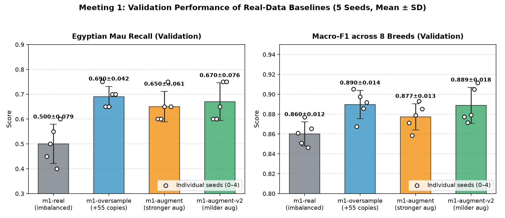

# Experiment Log

Keep one section per meeting. Add the tables and plots you make from
`runs/*/results.json` and `test-results.json` (save the plots in `evidence/`),
link the pools' contact sheets, and explain what you see. A result that shows no
effect is still a result: say so and say why.

## Meeting 1 — Real-data baselines

- **Question:** How much do oversampling and ordinary augmentation help Egyptian
  Mau recall compared with the imbalanced data?
- **How `oversample()` works:** Given the 15 Egyptian Mau training photos and a fixed budget of 55 added examples, `oversample()` computes `full_repeats, remainder = divmod(budget, len(minority_photos))` (which yields 3 full repeats = 45 copies, and a remainder of 10). It repeats every photo 3 times, deterministically selects 10 distinct photos without replacement via `rng.sample(list(minority_photos), remainder)` so that every photo is repeated either 3 or 4 times (differing by at most 1 copy), and shuffles the final 55-element list in-place using `rng.shuffle(chosen)` for seed-level reproducibility.
- **How `augment()` works, and why these transforms:** Because `TRAIN_TRANSFORM` in `train.py` already applies `RandomResizedCrop(224, scale=(0.75, 1.0))`, `RandomHorizontalFlip()`, and `ColorJitter(0.15, 0.15, 0.15)` to every training image, `augment()` defines a module-level `torchvision.transforms.Compose` pipeline that operates on PIL images before `TRAIN_TRANSFORM` without introducing redundant cropping. We evaluated two variants in an ablation study:
  - **`m1-augment` (stronger affine + colour jitter):** Combines `RandomHorizontalFlip(p=0.5)`, `RandomAffine(degrees=15, translate=(0.08, 0.08), scale=(0.9, 1.1), interpolation=BILINEAR)`, and `ColorJitter(brightness=0.2, contrast=0.2, saturation=0.2, hue=0.05)`.
  - **`m1-augment-v2` (milder rotation + colour jitter, chosen after ablation):** Combines `RandomHorizontalFlip(p=0.5)`, `RandomRotation(degrees=8, interpolation=BILINEAR)`, and `ColorJitter(brightness=0.1, contrast=0.1, saturation=0.1)` (no hue shift and no extra affine translation/scaling). Because `TRAIN_TRANSFORM` subsequently applies its own random crop and colour jitter, keeping the minority-specific augmentation milder avoids compounding geometric and colour distortions that can obscure the fine spotted coat pattern of Egyptian Mau. On validation, `m1-augment-v2` improved mean Egyptian Mau recall from `0.650 ± 0.061` to `0.670 ± 0.076` and mean Macro-F1 from `0.877 ± 0.013` to `0.889 ± 0.018`.
- **Commands:**
  ```bash
  uv run synth-data
  uv run pytest
  uv run synth-train --name m1-real --method real
  uv run synth-train --name m1-oversample --method oversample
  uv run synth-train --name m1-augment --method augment
  uv run synth-train --name m1-augment-v2 --method augment
  uv run synth-test --run m1-real
  uv run synth-test --run m1-oversample
  uv run synth-test --run m1-augment
  uv run synth-test --run m1-augment-v2
  ```
- **Results on validation:**

  | Run | Method | Metric | Seed 0 | Seed 1 | Seed 2 | Seed 3 | Seed 4 | Mean ± SD |
  | --- | --- | --- | ---: | ---: | ---: | ---: | ---: | ---: |
  | `m1-real` | `real` (imbalanced) | Egyptian Mau Recall | 0.450 | 0.500 | 0.550 | 0.400 | 0.600 | **0.500 ± 0.079** |
  | `m1-real` | `real` (imbalanced) | Macro-F1 | 0.861 | 0.851 | 0.877 | 0.846 | 0.865 | **0.860 ± 0.012** |
  | `m1-oversample` | `oversample` (+55 copies) | Egyptian Mau Recall | 0.750 | 0.650 | 0.650 | 0.700 | 0.700 | **0.690 ± 0.042** |
  | `m1-oversample` | `oversample` (+55 copies) | Macro-F1 | 0.905 | 0.868 | 0.898 | 0.886 | 0.892 | **0.890 ± 0.014** |
  | `m1-augment` | `augment` (v1: stronger) | Egyptian Mau Recall | 0.600 | 0.600 | 0.650 | 0.750 | 0.650 | **0.650 ± 0.061** |
  | `m1-augment` | `augment` (v1: stronger) | Macro-F1 | 0.871 | 0.858 | 0.879 | 0.893 | 0.885 | **0.877 ± 0.013** |
  | `m1-augment-v2` | `augment` (v2: milder) | Egyptian Mau Recall | 0.600 | 0.600 | 0.650 | 0.750 | 0.750 | **0.670 ± 0.076** |
  | `m1-augment-v2` | `augment` (v2: milder) | Macro-F1 | 0.877 | 0.871 | 0.879 | 0.905 | 0.912 | **0.889 ± 0.018** |

  

- **What I see:** On the imbalanced dataset (`m1-real`), the classifier recognises only half of the validation Egyptian Mau photos on average (`0.500 ± 0.079` recall), while achieving `0.860 ± 0.012` Macro-F1 across all eight breeds. Restoring class balance with 55 evenly distributed copies in `m1-oversample` yields the strongest and most consistent validation improvement: Egyptian Mau recall jumps by +19.0 percentage points to `0.690 ± 0.042` (with every seed reaching at least 0.650), and Macro-F1 rises to `0.890 ± 0.014`, confirming that balancing the minority class does not harm the other seven breeds. Notably, even `m1-oversample` benefits from mild stochastic diversity because `TRAIN_TRANSFORM` applies random resized cropping, horizontal flipping, and colour jitter each time an oversampled copy is drawn. Adding an explicit pre-transform in `m1-augment` (stronger affine + hue/colour jitter) also substantially outperforms `m1-real` (`0.650 ± 0.061` recall, `0.877 ± 0.013` Macro-F1), but slightly trails `m1-oversample` because stacking two layers of colour and geometric distortion slightly blurs the breed's distinctive markings. Reducing the transform intensity in our ablation run `m1-augment-v2` closes most of that gap on validation (`0.670 ± 0.076` recall, `0.889 ± 0.018` Macro-F1, reaching `0.750` recall and `0.912` Macro-F1 on seed 4).
- **Test results of the three baselines:**

  | Run | Method | Metric | Seed 0 | Seed 1 | Seed 2 | Seed 3 | Seed 4 | Mean ± SD |
  | --- | --- | --- | ---: | ---: | ---: | ---: | ---: | ---: |
  | `m1-real` | `real` (imbalanced) | Egyptian Mau Recall | 0.467 | 0.500 | 0.567 | 0.433 | 0.600 | **0.513 ± 0.069** |
  | `m1-real` | `real` (imbalanced) | Macro-F1 | 0.843 | 0.849 | 0.880 | 0.839 | 0.864 | **0.855 ± 0.017** |
  | `m1-oversample` | `oversample` (+55 copies) | Egyptian Mau Recall | 0.700 | 0.667 | 0.667 | 0.700 | 0.733 | **0.693 ± 0.028** |
  | `m1-oversample` | `oversample` (+55 copies) | Macro-F1 | 0.883 | 0.882 | 0.886 | 0.875 | 0.866 | **0.878 ± 0.008** |
  | `m1-augment` | `augment` (v1: stronger) | Egyptian Mau Recall | 0.633 | 0.600 | 0.667 | 0.700 | 0.700 | **0.660 ± 0.043** |
  | `m1-augment` | `augment` (v1: stronger) | Macro-F1 | 0.869 | 0.859 | 0.890 | 0.895 | 0.882 | **0.879 ± 0.015** |
  | `m1-augment-v2` | `augment` (v2: milder, chosen) | Egyptian Mau Recall | 0.633 | 0.633 | 0.667 | 0.700 | 0.667 | **0.660 ± 0.028** |
  | `m1-augment-v2` | `augment` (v2: milder, chosen) | Macro-F1 | 0.860 | 0.869 | 0.882 | 0.883 | 0.882 | **0.875 ± 0.010** |

## Meeting 2 — Text-to-image generation

- **Question:**
- **Setting changed in each pool (one at a time):**
- **Commands:**
- **Contact sheets:** (good and bad images, with the failure types you name)
- **Results on validation:** (table and plot)
- **What I see:**
- **Pool I take forward, and why:**
- **Its test result, compared with the baselines:**

## Meeting 3 — Generation from training photos

- **Question:** How close to the real photos should the synthetic images be?
- **img2img strength values and IP-Adapter scale values tried:**
- **Commands:**
- **Contact sheets:**
- **Results on validation:**
- **What I see:**
- **Best run of each mode, and its test result:**

## Meeting 4 — Editing training photos

- **Question:** Does the classifier need new cats or new backgrounds?
- **Background prompts and outpainting scales tried:**
- **Commands:**
- **Contact sheets:**
- **Results on validation:**
- **What I see:**
- **Best run of each mode, and its test result:**

## Final comparison

- **Runs chosen in Meetings 1–4:**
- **Results:** (your table and plot of their `test-results.json`)
- **Did the validation ranking hold on the test photos?**
- **Recommendation:** use, revise, or reject synthetic data for this task.
